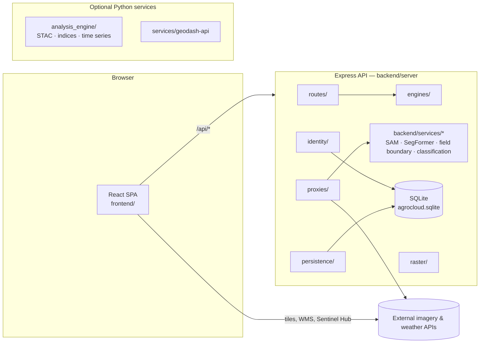

# AgroCloud architecture

AgroCloud is an npm-workspaces monorepo: a React single-page app (`frontend/`) and an Express API (`backend/`), plus optional Python services for satellite analysis and AI models. The SPA is published to GitHub Pages from `main:/docs`; the API runs on Hostinger, a VPS or Railway.



## Repository layout

```text
AgroCloud/
├─ frontend/               React + TypeScript SPA (Vite, MUI, MapLibre/Mapbox)
│  ├─ src/
│  │  ├─ app/              shell: providers, routes, startup, header/nav layouts, Home hub
│  │  ├─ modules/          features, one folder per domain (see Feature modules)
│  │  ├─ components/       shared UI kit — import via @/components
│  │  ├─ core/             infrastructure only: api, auth services, state, hooks, routing, i18n, config, utils
│  │  ├─ theme/            design tokens + MUI theme
│  │  └─ assets/styles/    global CSS (agro-premium.css loads last)
│  ├─ public/              static files copied into every build (icons, CNAME, schemas)
│  ├─ tests/               Playwright E2E
│  └─ scripts/             frontend tooling (check-imports, brand assets)
├─ backend/                Express API
│  ├─ server/              runtime: routes/ proxies/ engines/ persistence/ middleware/ services/ identity/ raster/
│  ├─ src/                 versioned /api/v1 · /api/v2 routers, error handler
│  ├─ services/            Python model services (SAM, SegFormer, field boundary, classification …)
│  ├─ database/            SQLite schema: migrations/ (applied on start), postgres-legacy/ (import reference), README
│  ├─ data/                agrocloud.sqlite — the database file (gitignored; a volume in Docker)
│  ├─ scripts/             db:migrate · db:status · db:backup · db:import-postgres
│  ├─ tests/               node --test
│  └─ docs/                identity architecture
├─ services/geodash-api/   optional FastAPI service
├─ analysis_engine/        Python STAC / spectral-index / time-series engine
├─ core/                   project material that isn't the running app
│  ├─ docs/                DEPLOYMENT, AUTHENTICATION, CREDITS, REPOSITORY, technical docs, examples/
│  ├─ database/            reference PostGIS schema for external GIS sources (not the app database)
│  ├─ tools/               standalone utilities (data-entry page, field-report comparison scripts)
│  └─ scripts/windows/     Windows launchers
├─ design-system/          design rules (UI UX Pro Max) + implementation guide
├─ scripts/                build, deploy and dev scripts used by npm and CI
├─ docs/                   GENERATED website for GitHub Pages — CI only, gitignored locally
├─ .github/workflows/      CI/CD (Pages, VPS, health checks)
├─ .claude/skills/         agent skills used for UI, testing and review work
├─ server.js               Hostinger production entry (serves the API + frontend/dist)
├─ Dockerfile*, docker-compose*.yml, railway.toml
│                          stay at the root: Railway, Docker and the VPS fetch them by these paths
├─ ARCHITECTURE.md · README.md · SECURITY.md
└─ package.json            npm workspaces: frontend, backend
```

`docs/` is the only generated folder. The deploy workflow rebuilds it on every push to `main` (see [core/docs/DEPLOYMENT.md](core/docs/DEPLOYMENT.md)); never edit it by hand.

## Frontend (`frontend/src`)

Dependencies point downward only: `app → modules → components / core / theme`. `core` and `components` never import from `modules`.

| Layer | Holds | Examples |
|---|---|---|
| `app/` | The shell: providers, routes, startup, header/nav layouts, Home hub. | `App.tsx`, `routes/AppRoutes.tsx`, `layouts/HeaderBar.tsx` |
| `modules/<feature>/` | Feature code: pages, feature components, hooks, services. One folder per domain. | `operations/`, `remote-sensing/`, `gis/`, `admin/`, `account/` |
| `components/` | Shared, feature-agnostic UI. Import via `@/components`. | `PageContainer`, `PageHeader`, `StatePanel`, `KpiCard`, `SkipLink`, `MapView` |
| `core/` | Infrastructure only — no pages. | `api/`, `auth/` (services), `state/`, `hooks/`, `routing/`, `localization/`, `config/`, `utils/` |
| `theme/` | Design tokens and the MUI theme. `assets/styles/agro-premium.css` mirrors the tokens as `--ds-*` CSS variables. | `tokens.ts`, `createAgroTheme.ts` |
| `assets/styles/` | Global and legacy stylesheets; `agro-premium.css` loads last. | |

### Feature modules

| Module | Scope |
|---|---|
| `account` | Login, profile, account settings pages. |
| `admin` | System Settings (+ sections), GitHub integration, AgroCloud management. |
| `identity` | Users, roles, hierarchy (server RBAC UI) and their API hooks. |
| `manpower` | Seat allocation. |
| `operations` | Daily data entry: fertigation, irrigation, harvest, QHIS, EC/pH, sensors, GPS. |
| `forms` | Data-source field engine behind the data-entry pages. |
| `dashboards` | Overview, AI pages, Agro Cloud Platform, Develop Elite dashboard, dashboard management. |
| `gis` | GIS map workspace, layers, content portal, editing, measurement, spatial analysis. |
| `remote-sensing` | Satellite Intelligence workspace: imagery, indices, classification, change detection, terrain, imagery-weather analysis. |
| `weather` | Weather Intelligence dashboard (forecast, charts, alerts). Distinct from `remote-sensing/weather`, which analyses weather *for imagery* (CHIRPS, WaPOR, climate reports). |
| `ai` | Geo-AI agent, detection, segmentation, training. |
| `reports`, `data-management`, `master-data` | Report generation, import/export, schemas. |

### Built but not wired into navigation

These modules compile and are kept intentionally; they have no route yet. Wire them up or remove them deliberately — don't treat them as dead code:
flood simulation (`gis/flood-simulation/`), crop classification panels (`remote-sensing/classification/`), EO layer enrichment + DOCX report (`remote-sensing/imagery/EoLayerEnrichment*`, `reports/analytics/eoEnrichmentReport/`), Sentinel scene search and calendar, AOI mask builder, raster georeferencing, image-classification wizard, DL train-model panel, vector layer export, generic `reports/operational/ReportModal`.

### Performance rules

- Every page route is lazy-loaded (`core/routing/lazyWithRetry`). Never import a page or chart/PDF/Excel code statically from the shell.
- `vite.config.ts → manualChunks` assigns React core, `@babel/runtime` and Vite's preload helper to `vendor-react` / `vendor-runtime`. Rollup folds unassigned shared dependencies into the first manual chunk that uses them, which previously made every page download the PDF and chart libraries. First load is ~270 KB gzip.

## Backend (`backend/server`)

| Folder | Holds |
|---|---|
| `index.js` | Entry point: middleware, route registration, startup checks. |
| `loadProductionEnv.js` | Loads `.env.production` / `.env` before anything else. |
| `routes/` | Feature routes served directly (weather, CHIRPS, GFS raster, GIS gateway, embed checks). |
| `proxies/` | Proxies to AI model services and external APIs, most with a built-in fallback. |
| `engines/` | Pure computation: field-boundary detection, crop classifier, Sentinel statistics, GeoTIFF encoding, training. |
| `database/` | SQLite connection (pg-style `query` / transactions), migration runner, document store, PostgreSQL importer. See [backend/database/README.md](backend/database/README.md). |
| `persistence/` | Stores built on the document store (admin directory, API secrets, user profiles); crop-classification job artifacts stay as files. |
| `middleware/` | Security headers, auth rate limiting. |
| `services/` | Auth, SMTP, API-secret bootstrap, local AI service supervisor. |
| `identity/` | Identity module (opt-in, `AGROCLOUD_IDENTITY=on`): users, roles, sessions, audit, manpower, credits — tables in the SQLite database. See `backend/docs/identity-architecture.md`. |
| `raster/` | COG pipeline, tile rendering, CRS / projection management. |
| `data/` | Bundled reference data. |

`backend/src/` holds the versioned `/api/v1`, `/api/v2` routers and the shared error handler.

All records (identity, API tokens, directory, profiles, EC/pH entries, dashboards, settings) are in one SQLite file — see [backend/database/README.md](backend/database/README.md). JSON files from older versions are imported on first read and kept as backups. Caches and binary outputs (raster tiles, classification artifacts) remain files.

## Design system

Tokens live in `frontend/src/theme/tokens.ts` (MUI) and `assets/styles/agro-premium.css` (`--ds-*`); both must stay in sync. Light/dark follows `<html data-theme>`. The rules are in `design-system/agrocloud/IMPLEMENTATION.md`, and `/style-guide` is the living reference.

Accessibility baseline (enforced by tests): visible keyboard focus on every control, a "Skip to content" link, Escape closes custom overlays, no `transition: all`, every stylesheet must parse.

## Testing

| Command (repo root) | Runs |
|---|---|
| `npm run lint` | ESLint across the repo (`eslint.config.mjs`): React hook rules and correctness rules for the frontend; undefined/unused names and unreachable code for the backend's plain JavaScript. |
| `npm run typecheck` | TypeScript (frontend), then the **strict-mode ratchet** (`typecheck:strict`): compiles with `tsconfig.strict.json` and fails if any file has more strict errors than `frontend/scripts/strict-baseline.json` allows. Fix errors and run `npm run typecheck:strict -w frontend -- --update` to lower the baseline; when it reaches zero, set `strict: true` in `tsconfig.json`. |
| `npm test` | Frontend unit tests (Vitest), then backend tests (`node --test`). |
| `npm run test:e2e` | Playwright against a production build: `desktop`, `tablet` and `mobile` projects, then a `perf` project (LCP/CLS budgets at 320–3840px) that runs alone afterwards so timings aren't skewed. `E2E_CROSS_BROWSER=1` adds Firefox and WebKit; `E2E_DEV_SERVER=1` uses the dev server; if the bundled Chromium build is missing, set `PLAYWRIGHT_CHROMIUM_EXECUTABLE`. |
| `npm run check:imports -w frontend` | Lists any import, `vi.mock` or CSS path that doesn't resolve. |
| `npm run build -w frontend` | Production build. |

## Development

```bash
npm install
npm run dev          # frontend (5180) + backend (3011)
npm run dev:client   # frontend only
npm run dev:server   # backend only
```

Deployment: [core/docs/DEPLOYMENT.md](core/docs/DEPLOYMENT.md). Authentication: [core/docs/AUTHENTICATION.md](core/docs/AUTHENTICATION.md). Credits: [core/docs/CREDITS.md](core/docs/CREDITS.md).
