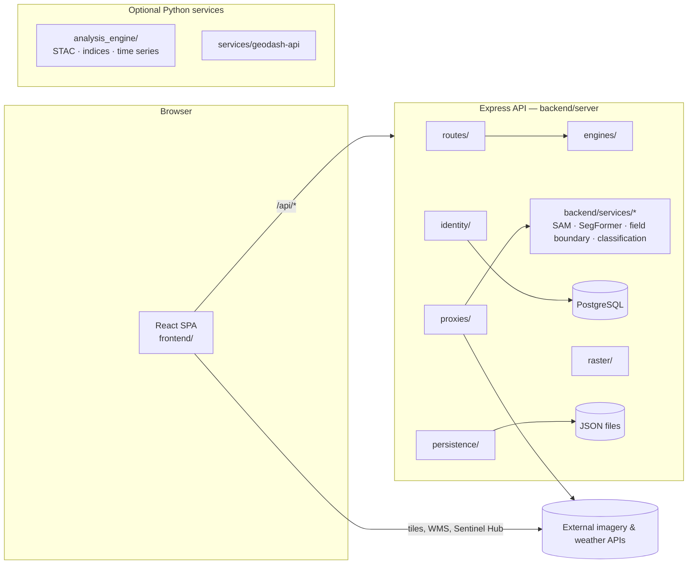

# AgroCloud architecture

AgroCloud is an npm-workspaces monorepo: a React single-page app (`frontend/`) and an Express API (`backend/`), plus optional Python services for satellite analysis and AI models. The SPA is published to GitHub Pages; the API runs on a VPS or Railway.



## Repository layout

| Path | What it is |
|---|---|
| `frontend/` | React 18 + TypeScript + Vite 5 + MUI 6 SPA (MapLibre / Mapbox GL for maps). |
| `backend/` | Express 4 API, identity (PostgreSQL), AI/imagery proxies, raster pipeline. |
| `backend/services/` | Python model services the API proxies to (SAM, SegFormer, agri field boundary, image classification, …). |
| `analysis_engine/` | Python STAC / spectral-index / time-series engine (called by `mpcPlanetaryApi`). |
| `services/geodash-api/` | Optional FastAPI service; enabled by `geodashApiUrl` in Agro Cloud Platform settings. |
| `scripts/` | Build, deploy and dev scripts used by npm and CI. |
| `design-system/agrocloud/` | Design rules (UI UX Pro Max output) and the implementation guide. |
| `core/` | Repository docs, SQL, Windows launchers and a standalone data-entry tool. |
| `.claude/skills/` | Agent skills used for UI, testing and review work. |
| repo root `index.html`, `assets/`, `sw.js`, `CNAME`, icons | **Generated** GitHub Pages output, synced by CI (`pages-sync` commits). Do not edit by hand. |

## Frontend (`frontend/src`)

Dependencies point downward only: `app → modules → components / core / theme`. `core` and `components` never import from `modules`.

| Layer | Holds | Examples |
|---|---|---|
| `app/` | The shell: providers, routes, startup, header/nav layouts, Home hub. | `App.tsx`, `routes/AppRoutes.tsx`, `layouts/HeaderBar.tsx` |
| `modules/<feature>/` | Feature code: pages, feature components, hooks, services. One folder per domain. | `operations/`, `remote-sensing/`, `gis/`, `admin/`, `account/` |
| `components/` | Shared, feature-agnostic UI. Import via `@/components`. | `PageContainer`, `PageHeader`, `StatePanel`, `KpiCard`, `SkipLink`, `MapView` |
| `core/` | Infrastructure only — no pages. | `api/`, `auth/` (services), `state/`, `hooks/`, `routing/`, `localization/`, `config/`, `utils/` |
| `theme/` | Design tokens and the MUI theme. `assets/styles/agro-premium.css` mirrors the tokens as `--ds-*` CSS variables. | `tokens.ts`, `createAgroTheme.ts` |
| `assets/styles/` | Global and legacy stylesheets; `agro-premium.css` loads last. | |

### Feature modules

| Module | Scope |
|---|---|
| `account` | Login, profile, account settings pages. |
| `admin` | System Settings (+ sections), GitHub integration, AgroCloud management. |
| `identity` | Users, roles, hierarchy (PostgreSQL RBAC UI) and their API hooks. |
| `manpower` | Seat allocation. |
| `operations` | Daily data entry: fertigation, irrigation, harvest, QHIS, EC/pH, sensors, GPS. |
| `forms` | Data-source field engine behind the data-entry pages. |
| `dashboards` | Overview, AI pages, Agro Cloud Platform, Develop Elite dashboard, dashboard management. |
| `gis` | GIS map workspace, layers, content portal, editing, measurement, spatial analysis. |
| `remote-sensing` | Satellite Intelligence workspace: imagery, indices, classification, change detection, terrain, imagery-weather analysis. |
| `weather` | Weather Intelligence dashboard (forecast, charts, alerts). Distinct from `remote-sensing/weather`, which analyses weather *for imagery* (CHIRPS, WaPOR, climate reports). |
| `ai` | Geo-AI agent, detection, segmentation, training. |
| `reports`, `data-management`, `master-data` | Report generation, import/export, schemas. |

### Built but not wired into navigation

These modules compile and are kept intentionally; they have no route yet. Wire them up or remove them deliberately — don't treat them as dead code:
flood simulation (`gis/flood-simulation/`), crop classification panels (`remote-sensing/classification/`), EO layer enrichment + DOCX report (`remote-sensing/imagery/EoLayerEnrichment*`, `reports/analytics/eoEnrichmentReport/`), Sentinel scene search and calendar, AOI mask builder, raster georeferencing, image-classification wizard, DL train-model panel, vector layer export, generic `reports/operational/ReportModal`.

### Performance rules

- Every page route is lazy-loaded (`core/routing/lazyWithRetry`). Never import a page or chart/PDF/Excel code statically from the shell.
- `vite.config.ts → manualChunks` assigns React core, `@babel/runtime` and Vite's preload helper to `vendor-react` / `vendor-runtime`. Rollup folds unassigned shared dependencies into the first manual chunk that uses them, which previously made every page download the PDF and chart libraries. First load is ~270 KB gzip.

## Backend (`backend/server`)

| Folder | Holds |
|---|---|
| `index.js` | Entry point: middleware, route registration, startup checks. |
| `loadProductionEnv.js` | Loads `.env.production` / `.env` before anything else. |
| `routes/` | Feature routes served directly (weather, CHIRPS, GFS raster, GIS gateway, embed checks). |
| `proxies/` | Proxies to AI model services and external APIs, most with a built-in fallback. |
| `engines/` | Pure computation: field-boundary detection, crop classifier, Sentinel statistics, GeoTIFF encoding, training. |
| `persistence/` | JSON-file stores (admin directory, API secrets, user profiles, crop-classification jobs). |
| `middleware/` | Security headers, auth rate limiting. |
| `services/` | Auth, SMTP, API-secret bootstrap, local AI service supervisor. |
| `identity/` | PostgreSQL identity: users, roles, sessions, audit, manpower, credits. See `backend/docs/identity-architecture.md`. |
| `raster/` | COG pipeline, tile rendering, CRS / projection management. |
| `data/` | Bundled reference data. |

`backend/src/` holds the versioned `/api/v1`, `/api/v2` routers and the shared error handler.

Runtime data stays where it always was: files that compute paths from their own location are anchored to `backend/server` or `backend/`, so existing saved config and caches are found after the reorganisation.

## Design system

Tokens live in `frontend/src/theme/tokens.ts` (MUI) and `assets/styles/agro-premium.css` (`--ds-*`); both must stay in sync. Light/dark follows `<html data-theme>`. The rules are in `design-system/agrocloud/IMPLEMENTATION.md`, and `/style-guide` is the living reference.

Accessibility baseline (enforced by tests): visible keyboard focus on every control, a "Skip to content" link, Escape closes custom overlays, no `transition: all`, every stylesheet must parse.

## Testing

| Command (repo root) | Runs |
|---|---|
| `npm run typecheck` | TypeScript, frontend. |
| `npm test` | Frontend unit tests (Vitest), then backend tests (`node --test`). |
| `npm run test:e2e` | Playwright: desktop, tablet and mobile projects. `E2E_CROSS_BROWSER=1` adds Firefox and WebKit. If the bundled Chromium build is missing, set `PLAYWRIGHT_CHROMIUM_EXECUTABLE`. |
| `npm run build -w frontend` | Production build. |

## Development

```bash
npm install
npm run dev          # frontend (5180) + backend (3011)
npm run dev:client   # frontend only
npm run dev:server   # backend only
```

Deployment: see [DEPLOYMENT.md](DEPLOYMENT.md). Authentication: see [AUTHENTICATION.md](AUTHENTICATION.md).
