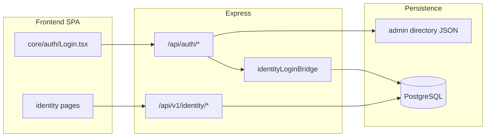

# AgroCloud — Architecture audit (Phase 1)

**Date:** 2026-03-08  
**Scope:** User platform (auth, identity, credits, admin) — evolve in place, no greenfield rewrite.  
**Production target:** PostgreSQL identity on API host; static SPA on GitHub Pages / `www.eliteagrocloud.com`.

---

## Tech stack

| Layer | Technology |
|--------|------------|
| Monorepo | npm workspaces — `frontend`, `backend` ([package.json](package.json)) |
| Frontend | React 18, Vite 5, React Router 6, MUI 6, Yup, HashRouter SPA |
| Backend | Node 20+, Express 4 ([backend/server/index.js](backend/server/index.js)) |
| Database | PostgreSQL via `pg` when `DATABASE_URL` is set ([backend/server/identity/db.js](backend/server/identity/db.js)) |
| ORM | None — SQL in identity services |
| Email | Nodemailer ([backend/server/authService.js](backend/server/authService.js)) |
| Deploy | GitHub Pages + `api.eliteagrocloud.com` |

---

## Current architecture

- **Legacy directory auth:** file-backed users, `/api/auth/register|login|verify-email|resend-verification`.
- **PostgreSQL identity:** migrations `001`/`002`, RBAC, sessions (`agro_session` cookie), audit, manpower (seat pool — not user credits).
- **Login:** `/api/auth/login` tries PG first, then JSON fallback.

---

## Existing authentication

| Feature | JSON directory | PostgreSQL |
|---------|----------------|------------|
| Sign up | Yes | Admin `createUser`; bridge on login |
| Sign in | Yes | Yes (cookie session) |
| Sign out | Client + `/api/v1/identity/logout` | Session row deleted |
| Email verify | Yes | Columns exist; parity via façade |
| Forgot / reset password | JSON + PG | `password_reset_tokens`, `/api/auth/forgot-password`, `/api/auth/reset-password` |
| Rate limiting | — | `authRateLimit.js` on auth routes |
| Sessions | Local | `sessions.last_active_at` (migration 003) |
| Credits wallet | — | `wallets` + `credit_transactions` (migration 004), `/api/v1/credits/*` |

Passwords: scrypt (new), SHA-256 legacy with upgrade on login.

---

## Existing user model (PostgreSQL)

Table `users`: UUID, `organization_id`, `email`, `name`, `role_id`, `status`, `password_hash`, `email_verified`, `last_login_at`, hierarchy fields.

**Gaps addressed incrementally:** `avatar_url`, `deleted_at` (003); canonical client id via `uuid` in `mapUserForClient`.

**Roles:** `OWNER`, `DIRECTOR`, `MANAGER`, `SUPERVISOR`, `STAFF` + permission codes (not hardcoded `if (admin)` on identity routes).

**Legacy JSON:** numeric `id`, roles Viewer/Editor/Manager/Admin.

---

## Credits / billing (before platform work)

- No wallet or SaaS credits; **manpower** allocations mirror transactional patterns.
- **Phase 6:** `wallets`, `credit_transactions`, `creditsService.js` (atomic debit/credit).

---

## Admin capabilities

- Users, roles, permissions, hierarchy, manpower — `/api/v1/identity/*`, MUI pages under `frontend/src/modules/identity/`.
- No unified KPI admin dashboard yet (planned Phase 9+).
- Audit: `audit_logs` + `auditService.js`.

---

## Problems (tracked)

1. Dual identity stores — mitigate by PG-as-canonical in production; keep JSON for dev/Pages-offline.
2. Auth product gaps — reset password, rate limits (**in progress / done in 003–004**).
3. Session secret must be set in production (`IDENTITY_SESSION_SECRET`).
4. User list not paginated — Phase 10.
5. No centralized AI/GIS metering — hook via `usage_events` (Phase 7).

---

## Security risks

- Brute force on auth → rate limiting.
- Missing reset flow → token table + single-use tokens.
- IDOR → use UUID + `assertCanManageUser` / permissions on all new APIs.
- Never log passwords or raw tokens.

---

## Scalability risks

- Full user list load → pagination/cursor (planned).
- Indexes on `credit_transactions`, `usage_events` (planned 005).

---

## Recommended improvements (phased)

See implementation phases in repo docs: `AUTHENTICATION.md`, `CREDITS.md` (added with Phase 2+).

| Phase | Focus |
|-------|--------|
| 1 | This audit |
| 2 | Documentation |
| 3 | DB user/auth foundation (003) |
| 4 | Auth façade (reset, rate limit) |
| 5 | Sessions UI (revoke others) |
| 6 | Credits ledger (004) |
| 7–18 | Usage, plans, admin KPIs, tests, security review |

---

## Files to modify (platform work)

**Do modify:** `backend/server/authService.js`, `backend/server/identity/*`, `backend/migrations/003+`, `frontend/src/core/auth/*`, `frontend/src/modules/identity/*`, new `modules/billing` or admin shell.

**Do not modify lightly:** GIS/develop-elite map stack, Pages root `assets/*`, deploy workflows, unless required for API cookies/CORS.

---

## Decisions (approved for implementation)

1. **PostgreSQL** is canonical for production API; JSON directory remains optional fallback.
2. **Admin UI** extends MUI shell / identity pages; login card visual identity preserved.
3. **Migrations** additive only; no destructive drops without explicit approval.

---

## ملخص عربي

المشروع يستخدم مصادقة مزدوجة (ملف JSON وPostgreSQL). الهوية في قاعدة البيانات تدعم الأدوار والصلاحيات والجلسات والتدقيق. لا يوجد نظام رصيد credits سابقاً؛ يُبنى ledger ذري مشابه لمنطق manpower. التطوير تدريجي على `/api/auth` و`/api/v1` دون إعادة كتابة الواجهة أو الخرائط.
